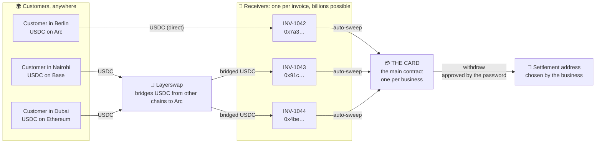
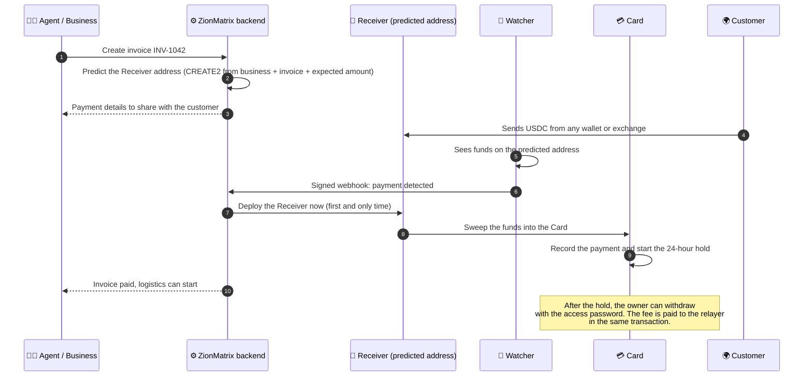
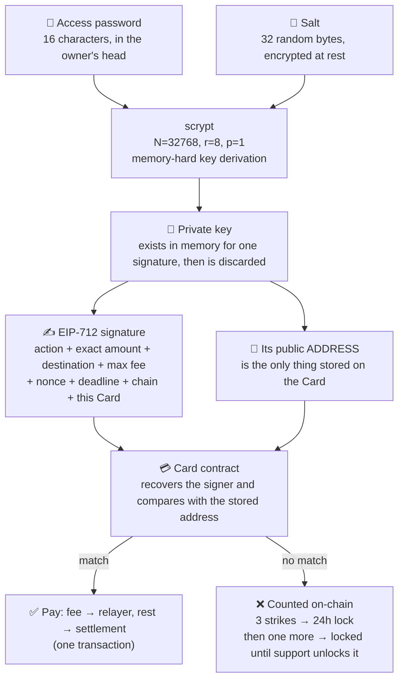
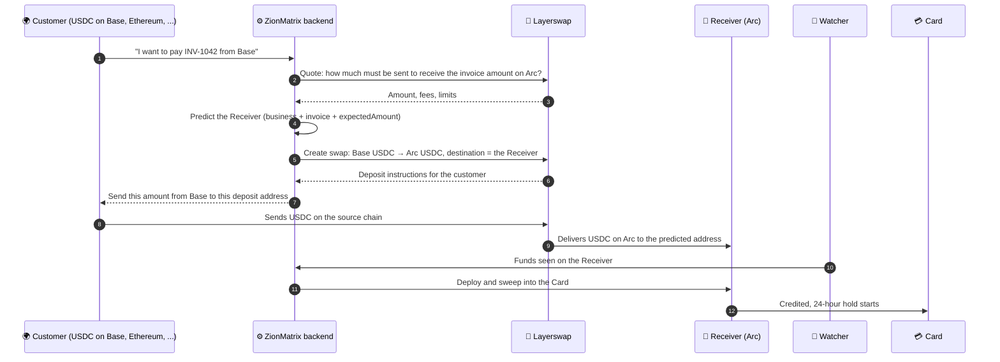
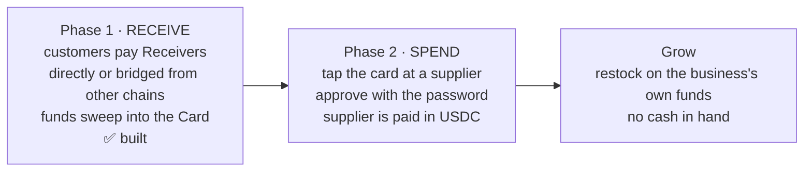

<div align="center">

# 💳 ZionMatrix Arc

### The Card for borderless business, settled in USDC.

**Every business gets a Card. Every invoice gets its own Receiver. Customers anywhere pay from any chain, and the money lands in a Card that only its owner's password can open.**

`Solidity 0.8.37` · `OpenZeppelin 5.6` · `Arc (native USDC)` · `EIP-712` · `CREATE2` · `Layerswap` · `NXP MIFARE DESFire EV3` · `Node.js SDK`

</div>

---

## 🌍 Why this exists

Small businesses lose international customers for one boring reason: **they cannot receive the payment.**
A buyer abroad cannot easily pay into a local account, and the usual processors do not cover every country a merchant operates from.
The workaround ("send it to this crypto wallet") is manual, unprofessional, and frightening for both sides.

Crypto adds a second problem: **the customer's USDC is often on the wrong chain.** A buyer may hold USDC on Ethereum, Base, Arbitrum, Solana or elsewhere, but the business settles on Arc.
ZionMatrix closes that gap with [Layerswap](https://layerswap.io): the customer pays from the chain they already use, and the funds arrive at the invoice's Receiver on Arc.

**ZionMatrix** gives every business an AI workforce that talks to customers on WhatsApp, records every sale, watches the market and finds new buyers, all from one connected memory of how the business actually runs. It already runs sales, stores, agents and logistics for **100+ businesses**.
This repository is the money layer that lets those businesses collect USDC from customers worldwide, while the experience stays what a business already understands: **a Card, an invoice, a payment, a settlement.** No wallets to explain. No gas. No addresses to copy by hand.

---

## 💳 The idea: the Card

A business has **one Card**. It is a smart contract on Arc, and it is the business's main place for money. For every customer invoice, the Card can create a **Receiver**: a tiny contract with its own payment address. Whatever a customer sends to a Receiver is **swept** straight into the Card, and the Card always knows which invoice it belongs to.

There are no private keys to manage for any Receiver. Its address is **predicted** from `(business, invoice, expectedAmount)` and the contract only exists once money arrives.

| Piece | What it is |
|---|---|
| **Card** | One smart contract per business: the main account that holds the money. It receives USDC, holds new payments for 24 hours, enforces limits and pays out only to the settlement address the business chose. |
| **Receiver** | One per invoice. A predicted address that costs nothing until a payment arrives. It is deployed the moment money is sensed on it, and **sweeps** into the Card. |
| **Access password** | 16 characters that exist only in the owner's head. No password, no withdrawal. |
| **Layerswap route** | A customer with USDC on another chain pays through Layerswap, and the swap's destination is the invoice's Receiver. |
| **Limits** | Withdrawal limits the business sets itself. |
| **Freeze and reversal** | Compliance can freeze a Card, and reverse a payment during its 24-hour hold. |
| **Events** | Every payment is an on-chain event, streamed to your backend as signed webhooks. |
| **The physical card** | An **NXP MIFARE DESFire EV3** NFC card for every business, the real-world face of its Card. |



Each Card can create an effectively unlimited number of Receivers. Nothing is stored for an invoice until money actually arrives: the address is derived, not created.

---

## 🔄 One payment, end to end



**Why predicted addresses?** The customer gets a clean, unique destination per invoice immediately, and the backend only spends gas on a Receiver when a payment really shows up. A watcher monitors the predicted address; when funds arrive it signals the backend, which deploys the Receiver and sweeps. The business is credited the full invoice amount; any surplus (for example the processing fee a customer adds at checkout) goes to the relayer to cover gas.

---

## 🔐 Self-custodial by design: the password

> **No password, no withdrawal.** Not for the business, not for ZionMatrix, not for anyone.

- It is **16 random characters** (generated, about 96 bits of randomness).
- It **lives only in the business owner's head**: it is never stored and never transmitted.
- It **never goes on-chain**, not even hashed.

**How that works**



- The contract stores only an **address**. To check a withdrawal it rebuilds the typed message itself and recovers who signed it. The password and the key are never seen.
- Every signature commits to **one action, exact amounts, the destination, a nonce and a deadline, on one chain, for one Card**. It cannot be replayed, redirected or reused for something else.
- **Wrong attempts are written on-chain and cannot be undone.** Three wrong tries lock the Card for 24 hours. A wrong try after that locks it until the admin unlocks it. An attacker gets at most four guesses, ever.
- Guessing offline is not an option either: it needs the **salt** as well as the address, and 96 bits of randomness behind a memory-hard function is out of reach.
- The **relayer** (ZionMatrix's server) only *submits* transactions and pays gas. It cannot sign for a business.

---

## 🧱 How the contracts work

| Contract | Role |
|---|---|
| **`BusinessCardFactory`** | Creates one Card per business and holds the settings every Card follows: default fee, hold time, default limits, the published version, the relayer address. Also predicts Receiver addresses. It has no function that can move a business's money. |
| **`BusinessCard`** | The Card itself (an ERC-1967 proxy per business). Receives USDC, records and holds payments, pays out only to the settlement address, enforces limits, verifies the password signature. |
| **`PaymentReceiver`** | The Receiver. Deterministic address, deployed lazily on first payment, sweeps into the Card. |
| **`BusinessCardProxy` / `ICardFactory`** | The upgradeable proxy and the small interface a Card uses to ask its factory for settings. |

**What a Card does**

- 📥 **Money in.** Anyone can send native USDC at any time (even when the Card is frozen or locked). Each payment is recorded (payer, amount, time).
- 🕐 **24-hour hold.** New money cannot be withdrawn until the hold passes (between 24 and 25 hours, tracked per hour, never early). While it is held, the relayer or admin can **reverse** it. If a payer refuses the refund, it is queued for them and stays out of the business's reach.
- 💸 **Money out, in one transaction.** A withdrawal pays the **fee to the relayer** (default **1%, capped at 10 USDC**) and the **rest to the settlement address**. The fee covers gas, so the relayer is never out of pocket. Hard ceilings in the code: 5% and 100 USDC. The business signs the highest fee it accepts, so a fee change can never surprise it.
- 🧮 **Real balances.** `balance()` is the actual chain balance (`address(this).balance`). The only bookkeeping is *what is on hold*, which can only make money harder to take out, never easier.
- 📉 **Limits the business controls.** Withdrawals per day, daily total, per-withdrawal maximum. Tightening is instant; loosening waits 24 hours (and the relayer can stop it), so a stolen password cannot raise the limits and empty the Card at once.
- 🛡️ **Compromised settlement wallet?** The business moves to a new one with its password (24-hour delay, cancellable).
- 🧊 **Compliance.** The relayer can freeze a Card immediately; only the admin can lift it.
- ⬆️ **Updates the business approves.** The admin publishes a version on the factory. Every Card can see it. The business presses *update* and signs the exact version and fee; the gas fee is paid **from the Card's own available balance**, or the update is declined. Nobody can upgrade a Card without its password.
- 🔁 **Forgotten password.** Recovery sets a new password after a 72-hour public delay (the business or relayer can cancel). It never changes the settlement address, which is then locked for 7 days.

**Two wallets run everything**

| Wallet | Can | Cannot |
|---|---|---|
| **Admin** (kept offline) | set fees within the ceilings, hold time, default limits; publish versions; unlock Cards; start recoveries; replace the relayer | move any business's money; change a settlement address, password or limits |
| **Relayer** (the server) | create Cards; submit transactions the business approved; freeze; reverse held payments; collect fees | move money by itself; sign for a business; unfreeze |

**Built with:** Solidity 0.8.37 · OpenZeppelin 5.6 (`EIP712`, `ECDSA`, `ERC1967`/`UUPS`, `ReentrancyGuardTransient`, `Ownable2Step`, `Pausable`) · `CREATE2` for Receivers · Foundry (83 tests including fuzzing and an invariant that no USDC can leak) · ethers v6 · scrypt · Layerswap for cross-chain USDC payments · Arc, where USDC is the native coin.

---

## 🛡️ What ZionMatrix can and cannot touch

| ✅ Can | ❌ Cannot |
|---|---|
| Submit transactions the business approved with its password | Move a business's money without its password |
| Take the fee on an approved withdrawal (never above 5% / 100 USDC, never above what the business signed) | Change a settlement address, password or limits |
| Freeze a Card; reverse a payment **still on hold** | Reverse a payment after its hold has passed |
| Create a Layerswap swap whose destination is an invoice's Receiver | Send bridged funds anywhere except the invoice's Receiver (the destination is derived from the invoice) |
| Publish a version | Upgrade a Card (the business must approve each update with its password) |
| Start a forgotten-password recovery (public 72 hours, cancellable) | Redirect funds through recovery |
| Unlock a Card after verifying the business | Read the password |

> **Status:** thoroughly tested (83 contract tests, a 15-scenario end-to-end suite, an integration test) and **not yet independently audited**. Audit before holding large balances.

---

## 🚀 Install and use

**Requirements:** Node.js 20+, two wallets with a little USDC for fees, a Layerswap API key if you want to accept payments from other chains, and (optionally) [Foundry](https://getfoundry.sh) to work on the contracts.

```bash
git clone https://github.com/mitmelon/zionmatrix-arc.git
npm install
```

Fill in `.env` (the full list is in [`DEPLOYMENT.md`](DEPLOYMENT.md)):

```bash
ZION_NETWORK=testnet                        # testnet | mainnet  (the only switch)
ZION_ADMIN_PRIVATE_KEY_TESTNET=0x...        # owns the contracts; keep offline
ZION_RELAYER_PRIVATE_KEY_TESTNET=0x...      # your server; submits transactions, receives fees
ZION_SECRET_KEY=<64 hex characters>         # encrypts each business's salt
LAYERSWAP_API_KEY=...                       # only needed to accept cross-chain payments
LAYERSWAP_ARC_NETWORK=...                   # the Layerswap identifier for Arc (see layerSwapDestinations)
```

Get free test USDC for both wallets at <https://faucet.circle.com> (Arc Testnet), then:

```bash
npm run build:contracts
npm run deploy:testnet       # deploys the factory once per network
```

### Use the SDK

```js
const { ZionCards } = require('./sdk');

const zion = ZionCards.connect({
  rpcUrl: process.env.ZION_RPC_URL,
  privateKey: process.env.RELAYER_PRIVATE_KEY,
  secrets: new EncryptedFileSecretStore({
    path: path.resolve(__dirname, './storage/salts.json'),
    key: process.env.ZION_SECRET_KEY, //used for encryption
  }),
});

// Issue a Card (the business's main contract). No wallet on the business's side.
const card = await zion.createCard({ businessId: 'shop_123', settlement: '0xWherePayoutsGo' });
card.card;              // the Card's address
card.accessPassword;    // show it ONCE, e.g. "Xk7! mQ2p Ab9# Zr4T". It is never stored.

//Receiver for an invoice: a predicted address, nothing deployed yet
const va = await zion.paymentReceiver({ businessId: 'shop_123', invoiceId: 'INV-1042', expectedAmount: 100 });

//Has the customer paid? Is the Receiver deployed yet?
await zion.virtualRemitStatus({ businessId: 'shop_123', invoiceId: 'INV-1042' , expectedAmount: 100});

//Money sensed: deploy the Receiver and sweep it into the Card
const sweep = await zion.sweepInvoice({ businessId: 'shop_123', invoiceId: 'INV-1042', expectedAmount: 100 });
sweep.swept;            // '100.0' USDC moved into the Card

//Balances come straight from the chain
await zion.balances('shop_123');   // { total, onHold, available, withdrawableNow, holds: [...] }

//Listen for payments, with confirmations
const watcher = zion.watcher({ confirmations: 1 });
watcher.on('payment.received', (e) => markInvoicePaid(e.businessId, e.txHash, e.data.amount));
watcher.start();
```

Every failure is a `ZionError` with a plain sentence, a stable code and an HTTP status, for example
*"Wrong access password. 2 attempts left before this Card is locked."*: `res.status(err.httpStatus).send(err.toJSON())`.

---

## 🌉 Customers on other chains: Layerswap

Not every customer holds USDC on Arc. [Layerswap](https://layerswap.io) is a cross-chain bridge, and ZionMatrix uses it so a customer can pay an invoice **from another chain**.
The trick is that nothing about the invoice changes: the Receiver is still the predicted address, and Layerswap simply sets it as the **destination** of the swap.



**What this means in practice**

- 🎯 **The destination is the invoice.** The swap is created with the invoice's predicted Receiver as the destination address, so the bridged money can only land in that invoice's Receiver, and from there only into the owner's Card.
- 🔗 **Same sweep, same hold, same password.** Once the funds are on Arc, nothing differs from a direct payment: the watcher sees them, the backend deploys and sweeps, the 24-hour hold applies, and withdrawals still need the password.
- 🧾 **Reconciliation.** Each swap is created with a `referenceId` built from the invoice ID (`INV-1042_USDC_<timestamp>`), so a swap can always be matched to its invoice.
- 💱 **Quote first.** `expectedAmount` is what the business is owed; `amount` is what the customer *sends*. Layerswap charges its own fees, so quote the swap and choose `amount` so that at least `expectedAmount` arrives on Arc. A shortfall means the invoice is underpaid.
- 🔒 **`expectedAmount` is part of the address.** Store it with the invoice when you quote it and reuse the exact same value to predict, watch, sweep and create the swap. Never recompute it from a live rate.
- ✅ **The chain is the source of truth.** You can poll a swap with `layerSwapStatus` to show progress to the customer, but mark an invoice paid only when the funds are confirmed on the Receiver (the watcher, `virtualRemitStatus` or `verifyPayment`).

### Using Layerswap with the SDK

`ZionCards` exposes a small set of helpers. Each one takes a `layerSwap` client (the SDK ships a `LayerSwap` client; any object that provides `createSwap`, `sources`, `destinations`, `quote`, `detailedQuote` and `swap` also works).

| Method | What it does |
|---|---|
| `layerSwapSources({ layerSwap, destinationNetwork })` | Which source chains/tokens can pay into this destination. Use it to build the "pay from…" picker. |
| `layerSwapDestinations({ layerSwap, sourceNetwork })` | The reverse: where a given source network can send to. |
| `layerSwapQuote({ layerSwap, sourceNetwork, destinationNetwork, amount })` | A quick quote for a route and amount. |
| `layerSwapDetailedQuote({ layerSwap, sourceNetwork, destinationNetwork, amount })` | The full fee and limit breakdown, to show the customer before they pay. |
| `createLayerSwapRemit({ layerSwap, businessId, invoiceId, expectedAmount, sourceNetwork, destinationNetwork, amount })` | Predicts the invoice's Receiver and creates the swap with it as the destination. Returns `{ receiver, referenceId, request, swap }`. |
| `layerSwapStatus({ layerSwap, swapId })` | Current state of a swap, for progress display. |

Token defaults to `USDC` on both sides.

Set your Layerswap keys in your `.env` file:

```bash
LAYERSWAP_API_KEY=
LAYERSWAP_ARC_NETWORK=
```

```js
const { LayerSwap } = require('./sdk');

const layerSwap = new LayerSwap({
  apiKey: process.env.LAYERSWAP_API_KEY,
  sandbox: process.env.ZION_NETWORK === 'testnet',
});

const ARC = process.env.LAYERSWAP_ARC_NETWORK;   // Layerswap's identifier for Arc
const INVOICE = { businessId: 'shop_123', invoiceId: 'INV-1042', expectedAmount: 100 };

//Which chains can the customer pay from?
const sources = await zion.layerSwapSources({ layerSwap, destinationNetwork: ARC });

//What will it cost? Show this to the customer before they commit.
const quote = await zion.layerSwapDetailedQuote({
  layerSwap,
  sourceNetwork: 'BASE_MAINNET',
  destinationNetwork: ARC,
  amount: 101,                       // what the customer sends; pick it so >= expectedAmount arrives
});

//Create the swap. The destination is the invoice's Receiver.
const remit = await zion.createLayerSwapRemit({
  layerSwap,
  ...INVOICE,
  sourceNetwork: 'BASE_MAINNET',
  destinationNetwork: ARC,
  amount: 101,
});
remit.receiver;      // the Receiver on Arc that will receive the funds
remit.referenceId;   // ties the swap to the invoice
remit.swap;          // Layerswap's swap, including the deposit details to show the customer

//Show progress while the customer pays (optional).
await zion.layerSwapStatus({ layerSwap, swapId: remit.swap.id });

//The rest is the normal flow. When the funds land on the Receiver, sweep them.
await zion.virtualRemitStatus(INVOICE);   // has it arrived? is it deployed?
await zion.sweepInvoice(INVOICE);         // deploy the Receiver and sweep into the Card
```

> The source network name above is an example. Use the exact network and token identifiers that Layerswap returns from `layerSwapSources` / `layerSwapDestinations`.

---

## 🌐 Deploy on mainnet

| | Testnet | Mainnet |
|---|---|---|
| Chain ID | 5042002 | 5042 |
| RPC | https://rpc.testnet.arc.io | https://rpc.mainnet.arc.io |
| Explorer | https://explorer.testnet.arc.io | https://explorer.arc.io |

1. **Rehearse on testnet:** a lockout, an unlock, a reversal, a fee change, a recovery, an update.
2. **Make two new wallets** (never reuse testnet keys): the **admin** (deploys and owns the factory) and the **relayer** (your server). Fund the admin with a little USDC and the relayer with enough for gas.
3. **Configure** `.env` as above, with the mainnet values:
   ```bash
   ZION_NETWORK=mainnet
   ZION_ADMIN_PRIVATE_KEY_MAINNET=0x...
   ZION_RELAYER_PRIVATE_KEY_MAINNET=0x...
   ZION_CONFIRM_MAINNET=yes
   ```
4. **Deploy:** `npm run deploy`. It refuses unless the two wallets differ and you confirmed, and it checks the RPC really is chain 5042 before sending anything. The factory address is saved in `storage/zion/deployments.json`.
5. **Verify:** `npm run status` shows the admin, relayer, fee, hold and version.
6. **Operate:** keep the admin key offline, put the relayer key (and your Layerswap API key) in a secrets manager, run the listener under a process manager, alert when `zion.relayerHealth().low` is true, and authenticate every request before it can submit a password attempt (wrong attempts are counted on-chain).
7. **Cross-chain payments:** if you accept Layerswap payments, confirm the routes you offer (`layerSwapSources`) actually deliver USDC to Arc mainnet, and test one small swap end to end before going live.
8. **Audit** before holding real customer funds, and ask a lawyer about custody and money-transmission rules where you operate.

Testnet and mainnet run from the same code: flip `ZION_NETWORK` and restart. Cards, salts and listener progress are kept per network, and the SDK refuses to send to an RPC on the wrong chain.

---

## 🗺️ What's next: the Card that spends

Receiving is phase one. Phase two lets a business **pay its own suppliers with the same Card**, so it can restock without carrying cash.



- 🪪 **Every business gets a physical NXP MIFARE DESFire EV3 card**, a secure NFC smart card, as the real-world face of its Card contract.
- 🏪 **Pay suppliers by tapping the card.** The supplier is paid in USDC from the business's own Card; nothing is held by ZionMatrix.
- 🔐 **Still self-custodial.** Spending uses the same rule as withdrawals: no password, no payment. The password lives in the owner's head, is never stored and never transmitted.
- 📉 **Same safety rails.** The limits engine (per-payment, daily totals, daily count, 24-hour delay on loosening) is already in the contract and extends naturally to spending.
- 🧾 **Reconciliation built in.** Every payment in and out is an on-chain event your backend already receives.

---

## 📝 License

MIT